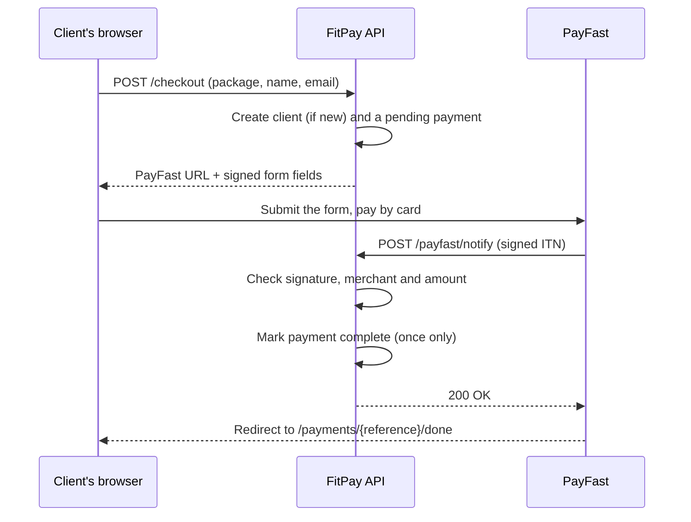

# FitPay API

[](https://github.com/garethkriel/fitpay-api/actions/workflows/ci.yml)


A Python REST API for coaching and fitness businesses: it tracks clients, sells packages through
[PayFast](https://payfast.io), records EFT and cash payments, and shows who is up to date, due
soon or overdue.

It's the Python version of the payments back end I built for a personal trainer in Bloemfontein,
rebuilt with FastAPI, SQLAlchemy and a full test suite.

## Features

- **Packages:** monthly plans and once-off programs, priced in rands.
- **Clients:** every client's payment status, worked out from their start date and payments:
  `up_to_date`, `due_soon`, `overdue`, `not_paid` or `finished` (for once-off programs). Clients who
  owe money are listed first.
- **PayFast checkout:** builds the signed form that sends a client to PayFast. No client account or
  password needed; clients are matched by email.
- **PayFast notifications (ITN):** checks the signature, the merchant and the amount before marking a
  payment as paid. Safe to receive twice, because PayFast retries.
- **Manual payments:** record EFT, cash and card-machine payments.
- **Reports:** revenue per month, the overdue list, and a CSV export of payments.
- **Command line:** `fitpay seed` (demo data), `fitpay overdue`, `fitpay serve`.
- **Quality:** 61 tests with 96% coverage, strict type checking (mypy), linting and formatting
  (ruff), and CI on every push.

## Tech stack

| Area | Tools |
| --- | --- |
| Web API | FastAPI, Pydantic v2, Uvicorn |
| Database | SQLAlchemy 2.0 (typed models); SQLite by default, PostgreSQL in Docker |
| Payments | PayFast checkout and ITN signature checks (MD5, per PayFast's spec) |
| Command line | Typer |
| Quality | pytest, mypy (strict), ruff, GitHub Actions |
| Deployment | Dockerfile and Docker Compose (API + PostgreSQL) |

## Quick start

You need Python 3.12 or newer.

```bash
git clone https://github.com/garethkriel/fitpay-api.git
cd fitpay-api
python -m venv .venv
```

Activate the virtual environment, with `.venv\Scripts\activate` on Windows or
`source .venv/bin/activate` on macOS and Linux, then:

```bash
pip install -e ".[dev]"
cp .env.example .env        # on Windows: copy .env.example .env
fitpay seed                 # adds 5 packages and 5 demo clients
fitpay serve
```

Open <http://127.0.0.1:8000/docs> for interactive API docs where you can try every endpoint.
To use the admin endpoints, set `FITPAY_ADMIN_API_KEY` in `.env` and click **Authorize** (or send
the key in an `X-API-Key` header).

### With Docker

```bash
docker compose up --build
docker compose exec api fitpay seed
```

This runs the API with PostgreSQL. CI builds and starts the same setup on every push.

## API overview

| Method | Path | Who | What it does |
| --- | --- | --- | --- |
| GET | `/health` | Anyone | Health check |
| GET | `/packages` | Anyone | Packages clients can buy |
| POST | `/checkout` | Anyone | Start a PayFast payment and get the signed form |
| POST | `/payfast/notify` | PayFast | Payment notification (ITN) |
| GET | `/payments/{reference}/done` | Anyone | Payment status after PayFast redirects back |
| POST, PATCH | `/packages`, `/packages/{id}` | Admin | Create and edit packages |
| GET, POST | `/clients` | Admin | List (filter by status, search) and add clients |
| GET, PATCH | `/clients/{id}` | Admin | One client with payments; edit or archive |
| POST | `/clients/{id}/payments` | Admin | Record an EFT, cash or card payment |
| GET | `/reports/revenue?year=2026` | Admin | Revenue per month |
| GET | `/reports/overdue` | Admin | Clients who are overdue |
| GET | `/reports/payments.csv` | Admin | All completed payments as CSV |

Example: add a client and record an EFT payment.

```bash
curl -X POST http://127.0.0.1:8000/clients \
  -H "X-API-Key: $FITPAY_ADMIN_API_KEY" -H "Content-Type: application/json" \
  -d '{"name": "Thandi Mokoena", "email": "thandi@example.com", "start_date": "2026-10-01"}'

curl -X POST http://127.0.0.1:8000/clients/1/payments \
  -H "X-API-Key: $FITPAY_ADMIN_API_KEY" -H "Content-Type: application/json" \
  -d '{"amount_cents": 100000, "months": 1, "method": "eft", "paid_on": "2026-10-01"}'
```

## How a PayFast payment works



## Design decisions

- **Money is stored in cents** (integers), so amounts never pick up floating-point errors.
- **Paid-up dates come from the start date plus months paid**, not from payment dates, so paying a
  few days early or late never gains or loses cover. The rules live in `billing.py` as plain
  functions, which makes them easy to test.
- **The ITN body is read raw**, because PayFast's signature depends on the exact field order it sent.
- **Notifications are idempotent:** a repeated notification for a completed payment is accepted
  without recording it twice, and a second, different PayFast payment for the same reference is refused.
- **"Today" is a dependency**, so tests can fix the date and status checks stay predictable.

## Configuration

All settings are environment variables (or `.env`), prefixed `FITPAY_`. See
[`.env.example`](.env.example) for the full list. The PayFast defaults are PayFast's public sandbox
merchant, so nothing is ever charged until you set your own merchant details and
`FITPAY_PAYFAST_SANDBOX=false`.

## Running the checks

```bash
pytest                 # 61 tests
mypy                   # strict type checking
ruff check .           # lint
ruff format --check .  # formatting
```

## Project structure

```
src/fitpay/
  api/app.py         FastAPI app, error handling
  api/deps.py        Database session, settings, "today", admin key check
  api/routes/        One file per area: packages, clients, checkout, payfast_notify, reports
  billing.py         Paid-up dates and client status (pure functions)
  payfast.py         Signatures, checkout fields, ITN verification
  services.py        Business logic between routes and the database
  models.py          SQLAlchemy tables
  schemas.py         Pydantic request and response models
  cli.py, seed.py    Command line and demo data
tests/               pytest suite
docs/HOW-IT-WORKS.md A plain-English walkthrough of the code
```

## Roadmap

- Database migrations with Alembic
- Email reminders for clients who are due soon or overdue
- PayFast subscriptions for monthly plans
- PayFast's server-side ITN validation call and source IP check

## How this was built

I designed and built this project with Claude Code as an AI pair programmer, then reviewed and
tested the code. [docs/HOW-IT-WORKS.md](docs/HOW-IT-WORKS.md) explains every part of it.

## Author

**Gareth Kriel**, junior software developer in Bloemfontein, South Africa.
[LinkedIn](https://www.linkedin.com/in/gareth-kriel-32a387378) ·
[GitHub](https://github.com/garethkriel)

## License

[MIT](LICENSE)
